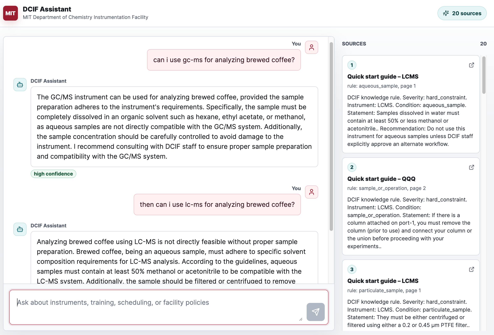

# DCIF Assistant

DCIF Assistant is a reproducible knowledge and retrieval system for the MIT Department of Chemistry
Instrumentation Facility. It crawls the official DCIF overview page and directly linked PDF
resources, turns them into structured knowledge, and exposes the result through a FastAPI backend and
a Next.js chatbot demo.

The chatbot is not the source of truth. The core of the project is the deterministic DCIF knowledge
pipeline: crawl, parse, structure, audit, index, retrieve, and cite.



## Motivation

The MIT Department of Chemistry Instrumentation Facility (DCIF) gives researchers access to
analytical chemistry instrumentation such as mass spectrometers, NMR spectrometers, HPLC, FTIR,
polarimetry, EPR, poster printing, and related training resources. Using these instruments well
requires domain expertise: users must choose the right technique, prepare samples correctly, follow
facility procedures, and avoid instrument-damaging mistakes.

That cost of misuse is high. A wrong solvent, aqueous sample, concentration, column condition, or
workflow can waste instrument time, produce misleading data, or take a shared instrument offline.
This project explores a practical LLM-assisted interface that is aware of DCIF instruments,
quick-start guides, application notes, fees, training material, and extracted operating constraints.
The goal is to help users learn the facility documentation, choose plausible instruments, and use
them more safely while preserving source citations.

## What It Does

- Fetches the DCIF overview page configured in `config/sources.yaml`.
- Fetches directly linked PDFs from that page, including Dropbox PDFs normalized to direct downloads.
- Preserves raw HTML/PDF snapshots and metadata under `data/raw`.
- Parses sources into normalized documents under `data/normalized`.
- Extracts deterministic overview records for instruments, fees, staff, guides, and facility
  sections.
- Builds hierarchical knowledge artifacts for documents, sections, instruments, resources, and
  explicit rules.
- Builds hybrid search indexes with SQLite keyword search and Chroma vector search.
- Serves retrieval and chat APIs through FastAPI.
- Provides a Next.js chatbot UI with markdown messages, loading state, citations, and source panels.
- Optionally uses Azure AI Foundry for answer synthesis while keeping retrieval deterministic.

## Current Knowledge Scope

The current crawl contract is intentionally narrow:

- one official DCIF overview HTML page;
- directly linked PDF files from that page;
- no recursive crawl of unrelated MIT Chemistry pages.

The local source catalog currently documents:

- 1 DCIF overview page;
- 43 linked PDF files;
- structured records for overview sections, instruments, fees, staff, guides, and resources;
- hierarchical knowledge artifacts for documents, sections, instruments, resources, and rules.

See [docs/dcif-source-catalog.md](docs/dcif-source-catalog.md) for the exact source list.

## Architecture

```text
MIT DCIF overview page + linked PDFs
  -> dcif crawl
  -> data/raw
  -> dcif parse
  -> data/normalized
  -> dcif extract-structured
  -> data/structured/records.jsonl
  -> dcif build-knowledge
  -> data/structured/{documents,sections,instruments,resources,rules}.jsonl
  -> dcif chunk
  -> data/chunks/chunks.jsonl
  -> dcif index
  -> data/indexes
  -> FastAPI /retrieve and /chat
  -> Next.js chatbot demo
```

The generated indexes are disposable. The canonical knowledge lives in the fetched source snapshots,
normalized documents, and structured knowledge artifacts.

## Retrieval Model

The assistant uses hierarchical, provenance-aware retrieval rather than a single flat vector search.

For inventory questions, it answers from structured instrument records. For instrument-specific
sample preparation or compatibility questions, it resolves the instrument, promotes explicit rules,
then retrieves supporting passages from the relevant quick-start guide. For broader recommendation
questions, it uses instrument profiles and constraints before asking the LLM to synthesize an answer.

Example behavior:

- "What mass spectrometry instruments do you have?" answers from the Mass Spectrometry catalog.
- "Can I use GC-MS for brewed coffee?" routes to GC/MS, surfaces the GCMS quick-start aqueous-sample
  constraint, and cites the relevant guide-derived rule.
- "Which tool should I use for coffee?" considers likely goals and compares candidate instruments
  rather than relying on one nearest-neighbor chunk.

## Tech Stack

Backend:

- Python 3.12
- FastAPI
- Typer CLI
- BeautifulSoup for HTML parsing
- PyMuPDF for PDF parsing
- SQLite for keyword indexing and crawl metadata
- Chroma for vector search
- Pydantic models for validated artifacts and LLM output

Frontend:

- Next.js
- React
- TypeScript
- `react-markdown` with GitHub-flavored markdown
- `lucide-react` icons

Optional LLM:

- Azure AI Foundry / Azure OpenAI v1 Responses API
- Strict JSON-schema outputs
- Source citation validation
- Deterministic fallback answers when LLM synthesis fails

## Setup

Create a virtual environment and install the backend:

```bash
python -m venv .venv
source .venv/bin/activate
pip install -e ".[dev]"
```

Install the frontend:

```bash
cd frontend
npm install
```

## Build The Knowledge Base

Run the full ingestion pipeline:

```bash
dcif ingest
dcif audit
```

Or run individual stages:

```bash
dcif crawl
dcif parse
dcif extract-structured
dcif build-knowledge
dcif chunk
dcif index
dcif audit
```

Useful retrieval smoke test:

```bash
dcif retrieve "What mass spectrometry instruments do you have?" --top-k 5
```

## Run Locally

Start the backend:

```bash
uvicorn backend.api.main:app --reload
```

Start the frontend in another terminal:

```bash
cd frontend
npm run dev
```

The frontend defaults to `http://localhost:8000` for the backend. Override it with:

```bash
NEXT_PUBLIC_API_BASE_URL=http://localhost:8000 npm run dev
```

Open the Next.js app at `http://localhost:3000`.

## API Endpoints

- `GET /health`: backend health check.
- `GET /llm/status`: current LLM configuration status without exposing secrets.
- `GET /debug/runtime`: runtime path, catalog, and retrieval diagnostics.
- `POST /retrieve`: raw hybrid retrieval results.
- `POST /chat`: chat answer plus retrieved sources.

Example:

```bash
curl http://127.0.0.1:8000/chat \
  -H 'Content-Type: application/json' \
  -d '{"message":"can i use gc-ms for analyzing brewed coffee?","top_k":5}'
```

## Azure Foundry LLM Configuration

The retrieval API works without an LLM. Chat synthesis is enabled only when `LLM_ENABLED=true`.

```env
LLM_ENABLED=true
LLM_PROVIDER=azure_foundry
LLM_FEATURE_MODE=responses
LLM_AZURE_ENDPOINT=https://<resource-name>.openai.azure.com
LLM_AZURE_MODEL=<deployment-name>
LLM_AUTH_MODE=api_key
LLM_AZURE_API_KEY=<key>
LLM_TIMEOUT_SECONDS=20
LLM_MAX_OUTPUT_TOKENS=1200
LLM_TEMPERATURE=0.2
LLM_PROMPT_VERSION=dcif-chat-v1
```

For production, prefer:

```env
LLM_AUTH_MODE=managed_identity
LLM_AZURE_SCOPE=https://ai.azure.com/.default
```

See [docs/azure-foundry-llm.md](docs/azure-foundry-llm.md) for provider-boundary, endpoint,
authentication, validation, and rollout details.

## Testing

Run the full test suite:

```bash
pytest -q
```

The tests cover crawl scope, parsing, structured extraction, knowledge organization, audit checks,
retrieval behavior, advisor routing, LLM payload validation, and API fallback behavior.

## Documentation

Start with [docs/README.md](docs/README.md). It links to:

- scraping architecture;
- retrieval architecture;
- knowledge organization;
- source catalog;
- reproducibility and website drift notes;
- Azure Foundry LLM implementation guidance.

## Maintenance Notes

- Update `config/sources.yaml` if the official DCIF overview URL changes.
- Run `dcif ingest && dcif audit` after source or parser changes.
- Prefer deterministic parser/extraction updates over LLM-based ingestion.
- Keep source snapshots and structured artifacts as the source of truth; rebuild indexes as needed.
- Add regression tests before changing extraction rules for instruments, fees, resources, or
  hard-constraint rules.
